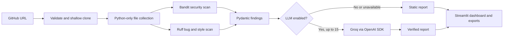

# AI Code Reviewer

**Neural Storm 2026 · FT-05 – AI-Powered Automated Code Review**  
Participant: **Yuvraj Rana (Solo)**

AI Code Reviewer is a Streamlit application for reviewing public Python repositories. It shallow-clones a GitHub repository, runs Bandit and Ruff against Python files, normalizes diagnostics, then optionally asks a Groq-compatible LLM to verify up to 15 findings. Repository code is never imported or executed.

## Architecture



## Features

- Shallow HTTPS clones restricted to public `github.com` repositories.
- Python-only checkout after preflight limits of 5,000 tracked files, 400 Python files, 25 MB of Python source, and 100 MB of tracked content.
- Bandit security analysis and Ruff error, bug-pattern, and modernization rules.
- Pydantic-normalized findings with severity, line numbers, source snippets, and stable identifiers.
- Optional Groq-compatible LLM verification, explanations, and remediation suggestions. Only the top 15 static findings are sent.
- Dark Streamlit dashboard with category and verification summaries, expandable findings, and JSON/Markdown exports.
- A 10-case seeded evaluation harness that calculates file-level precision and recall from actual scanner output.

## Setup

Python 3.10 or newer is recommended.

```bash
python3 -m venv .venv
source .venv/bin/activate
python -m pip install -r requirements.txt
cp .env.example .env
streamlit run app.py
```

Set `LLM_API_KEY` in `.env` to enable AI verification. `LLM_BASE_URL` defaults to `https://api.groq.com/openai/v1`, and `LLM_MODEL` defaults to `llama-3.3-70b-versatile`. For Streamlit Community Cloud, add the same keys to app secrets:

```toml
LLM_API_KEY = "your_groq_api_key"
LLM_BASE_URL = "https://api.groq.com/openai/v1"
LLM_MODEL = "llama-3.3-70b-versatile"
```

The app remains usable without an API key; AI verification is then reported as unavailable and static findings remain visible as unverified. Never commit `.env` or Streamlit secrets.

## Evaluation

Run the seeded scanner evaluation from the project root:

```bash
python eval/run_eval.py
```

This workspace's measured static result on the 10 seeded cases (8 positive, 2 safe controls):

| Mode | TP | FP | FN | TN | Precision | Recall |
| --- | ---: | ---: | ---: | ---: | ---: | ---: |
| Bandit + Ruff | 8 | 1 | 0 | 1 | 0.889 | 1.000 |
| Static + LLM | Not measured | Not measured | Not measured | Not measured | Not measured | Not measured |

The LLM evaluation was **not run** because `LLM_API_KEY` was not configured in the evaluation environment. `eval/run_eval.py` will calculate combined metrics only after a real LLM response labels findings; it does not substitute assumed or mocked scores. These are small, hand-seeded fixtures, not a representative benchmark.

## Limitations

- Public GitHub HTTPS URLs only; private repositories, other Git hosts, and branch/ref selection are not supported.
- Clone and Python checkout each time out after 90 seconds; scanner processes time out after 60 seconds each, and each LLM request times out after 30 seconds. Tracked tree limits are checked before Python files are checked out.
- Bandit and Ruff can miss issues or raise false positives. Static results are not a security guarantee.
- The LLM only reviews up to 15 findings, depends on external service availability, and may be incorrect. Unreviewed findings remain marked unverified.
- The evaluation corpus is intentionally small. Combined metrics require configured credentials and a successful, labeled response.
- Repository content is sent to the configured LLM only when verification is enabled; review public code only when that transfer is acceptable.

## AI Tools Used

- ChatGpt
- Copilot
