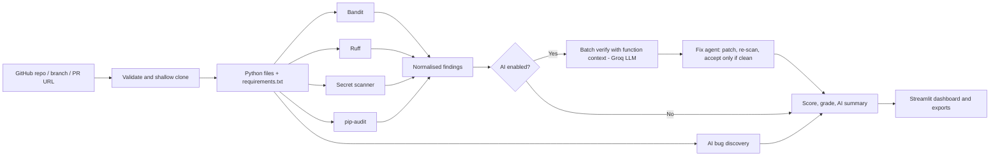

# AI Code Reviewer

**Neural Storm 2026 · Track: Future Tech · Sub-theme: AI Agents / Smart Automation (FT-05, AI-Powered Automated Code Review)**

## Problem Statement

Code review is a bottleneck for small teams. Linters produce long lists of noisy warnings, and reviewers waste time deciding which ones are real, how severe they are, and how to fix them. Security slips (hardcoded keys, unsafe deserialization, vulnerable dependencies) ship because nobody has time to triage hundreds of alerts.

**AI Code Reviewer** turns a GitHub link into a triaged, prioritized report with ready-to-apply patches. It is a small agent loop: **detect → verify → fix → re-scan**. Static analyzers find candidates, an LLM confirms or rejects each one using the surrounding function, proposes a patch, and the system re-runs the scanners on the patched code. A fix is labelled *verified* only if it still parses, removes the finding, and introduces no new ones.

## Team

| Name | Role | College | Contact |
| --- | --- | --- | --- |
| Yuvraj Rana | Solo: design, development, evaluation | `<ADD COLLEGE>` | `<ADD GITHUB / EMAIL>` |

## What it does

- **Three input modes:** a repository, a branch (`/tree/<branch>`), or a pull request (`/pull/<n>`, scanning only the changed Python files).
- **Static analysis:** Bandit (security), Ruff (bugs), a built-in **secret scanner** (AWS, GitHub, Groq, OpenAI, Slack, Google keys, private keys; secrets are redacted in every report), and **pip-audit** against pinned `requirements.txt` entries.
- **AI verification in parallel batches** (up to 40 findings). The model sees the *enclosing function*, not just a few lines, and marks each finding confirmed or false positive.
- **Auto-fix agent:** for confirmed findings the model proposes a replacement for the function. The patch is applied to a temp copy and re-scanned. It is shown as a diff with a **verified / not verified** badge.
- **AI bug discovery:** looks for logic bugs and security flaws linters miss in the largest files. Locations are validated, and hallucinated line numbers are discarded.
- **Health score and grade (A–F)**, an AI-written executive summary of what to fix first, severity and category charts, and JSON/Markdown export.
- **Transparency:** findings the AI filters out are never silently hidden. They stay in a collapsed "Filtered by AI" section so the decisions can be audited.

## Architecture



## Tech Stack

- **Language:** Python 3.10+
- **UI:** Streamlit
- **Analysis:** Bandit, Ruff, pip-audit, Python `ast`, custom secret patterns
- **AI:** Llama 3.3 70B via Groq through the OpenAI SDK (any OpenAI-compatible endpoint works)
- **Data and validation:** Pydantic v2, GitPython
- **Quality:** pytest (19 tests including a mocked-LLM end-to-end fix test), GitHub Actions CI, a seeded evaluation harness

## Setup

```bash
python3 -m venv .venv
source .venv/bin/activate
python -m pip install -r requirements.txt
cp .env.example .env     # then set LLM_API_KEY (free key at console.groq.com)
streamlit run app.py
```

Environment variables (in `.env` or Streamlit secrets):

| Variable | Purpose |
| --- | --- |
| `LLM_API_KEY` | Enables AI verification, auto-fix, discovery and summary. Without it the app still works as a static reviewer. |
| `LLM_BASE_URL` | Defaults to `https://api.groq.com/openai/v1` |
| `LLM_MODEL` | Defaults to `llama-3.3-70b-versatile` |
| `GITHUB_TOKEN` | Optional. Raises the GitHub API rate limit used to list changed files in PR mode. |

Run the tests and evaluation:

```bash
python -m pip install -r requirements-dev.txt
python -m pytest -q
python eval/run_eval.py
```

## Evaluation

`python eval/run_eval.py` runs the scanners on 28 hand-written cases (17 vulnerable, 11 safe controls) and computes file-level metrics from real scanner output:

| Mode | TP | FP | FN | TN | Precision | Recall |
| --- | ---: | ---: | ---: | ---: | ---: | ---: |
| Bandit + Ruff + secret scan | 17 | 1 | 0 | 10 | 0.944 | 1.000 |
| Static + LLM | Not measured | Not measured | Not measured | Not measured | Not measured | Not measured |

The single false positive is Bandit's low-severity B603 on a safe `subprocess.run([...])` call, which is exactly the kind of noise the AI verification stage exists to filter. The LLM row is left unmeasured here because no API key was configured when these numbers were produced. The script fills it in automatically when `LLM_API_KEY` is set; nothing is assumed or mocked. These fixtures are small and hand-seeded, so treat them as a sanity check, not a benchmark.

## Security design

- Repository code is **never imported or executed**; it is only parsed and scanned.
- Only HTTPS `github.com` URLs are accepted. Credentials, queries, path traversal and option-like branch names (`--upload-pack=...`) are rejected (see `tests/test_core.py`).
- Size limits: 5,000 tracked files, 400 Python files, 25 MB of Python source, 100 MB tracked content. Timeouts on clone and scanners.
- Detected secrets are masked in snippets, reports and exports.
- LLM prompts state that repository content is untrusted data, requests use JSON mode, and the output is schema-checked. A model-proposed patch is never trusted: it must pass a parse check and a re-scan.
- The app applies a per-session cooldown to limit abuse of a public deployment.

## Limitations

- Public GitHub only; private repositories and other Git hosts are not supported. Python only.
- PR mode lists changed files through the GitHub API; if it is rate limited the app says so and scans all Python files instead.
- Bandit, Ruff and the LLM can miss issues or raise false positives. "Verified" means the patch passed the scanners, **not** that behaviour is preserved. Review every diff before applying it.
- AI bug discovery covers only the 5 largest non-test files (up to 350 lines each) and is advisory. Findings are labelled *AI-detected*.
- Verification reviews up to 40 findings and auto-fix is attempted for the top 10; the rest remain *unverified*.
- The dependency audit covers pinned (`==`) entries of a root `requirements.txt` only.
- When AI features are enabled, code snippets are sent to the configured LLM provider. Only review code where that is acceptable.

## AI Tools Used

- **ChatGPT**: brainstorming the architecture and reviewing the prompts.
- **GitHub Copilot**: code completion while writing the app.
- **Claude**: used to review and extend the project during the hackathon window (auto-fix agent, PR mode, secret and dependency scanning, tests).
- **Inside the product:** Llama 3.3 70B (via Groq) performs verification, fix generation, bug discovery and summarisation.
